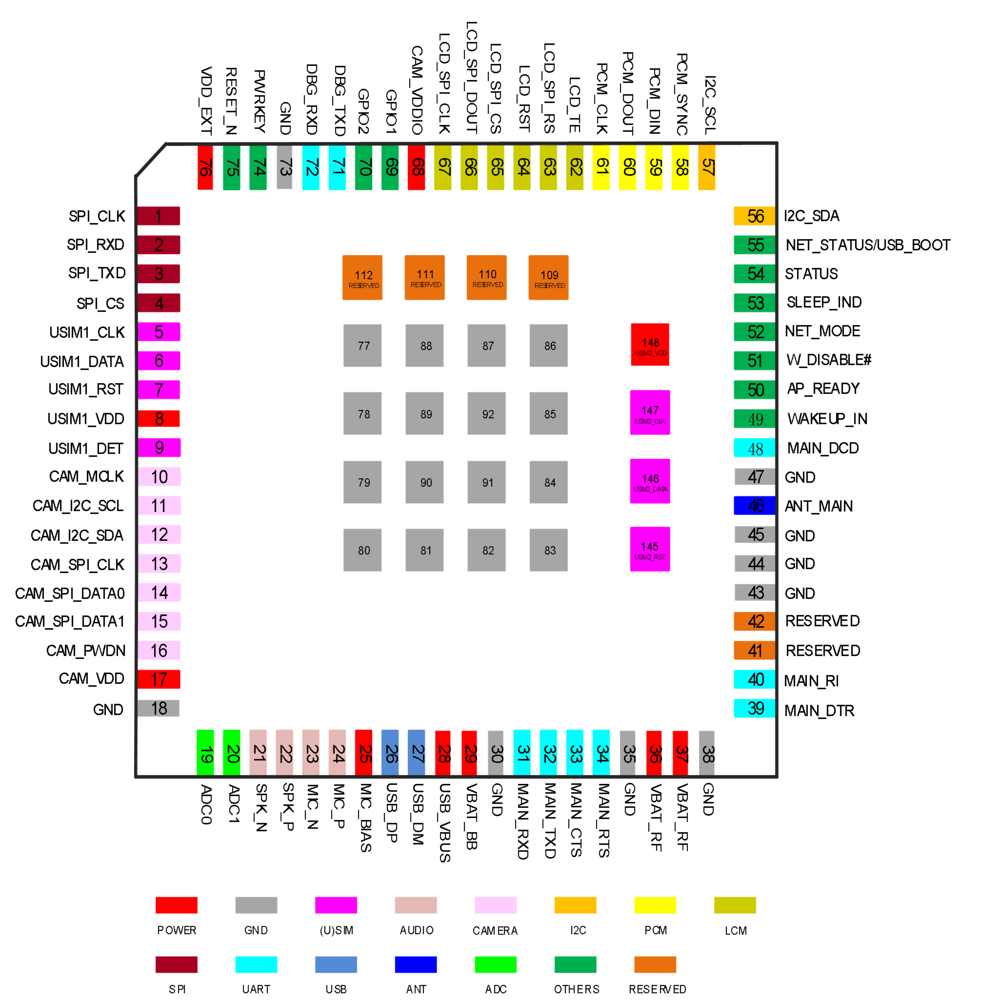

# 拉卡拉 CS80 客显屏 → Agent 状态屏

把一台 ¥30 的二手「拉卡拉客显屏音箱 CS80」改造成 **800×1280 的 Agent 状态副屏**：
年月日 + 大时钟 + agent 运行状态（运行中/等待输入/已完成/出错）+ 任务名 + CPU/内存/网络，**30 fps 实时刷新**。

**没有改硬件**：原屏、原主板、原 Type-C 供电，只刷了固件。

```
┌──────── Windows PC ────────┐   USB (Type-C, QDC1 协议)   ┌─── CS80 (EC600U + QDisplay) ───┐
│ QDisplay.Service.exe       │  ──────────────────────►    │ 解 LZ4 → 写 framebuffer        │
│  采样 CPU/内存/网络        │     800×1280 BGR565          │ cache-clean → DSI 提交 → 上屏   │
│  Dashboard.Draw() 画整屏   │     分块 + 压缩，30 fps       │ 按键调亮度 / 长按待机           │
└────────────────────────────┘                             └────────────────────────────────┘
        ▲ 读 C:\Users\<你>\cs80_display\state.json（agent 状态）
```

---

## 0. 当前状态

| 项 | 状态 |
|---|---|
| 硬件 | ✅ 未改动（原装屏 + 原主板，12V DC 或 Type-C 供电） |
| 固件 | ✅ QDisplay native APP（写在 `0x60260000`，154 KB） |
| 传输 | ✅ USB Type-C + QDC1 协议，实测 **30 fps** |
| 画面 | ✅ 自定义（年月日/时钟/agent 状态/任务/CPU/内存/网络） |
| 主机 | ✅ Windows 10/11 x64 |
| Mac | ⏳ 待测（见 [`mac/README.md`](mac/README.md)） |
| 恢复 | ✅ `fw.pac` 可刷回 QuecPython（见 §3.3） |

---

## 1. 快速上手

```bat
:: 便携 Python 在 win-flash\flash\py（没有就先解压 python-embed.zip 并装 pyserial）
set PY=win-flash\flash\py\python.exe

:: 设置 agent 状态（屏上立刻变）
%PY% win-display\agent_state.py running "重构 auth 中间件"
%PY% win-display\agent_state.py waiting
%PY% win-display\agent_state.py done
%PY% win-display\agent_state.py error "测试挂了"
%PY% win-display\agent_state.py idle
```

状态文件：`%USERPROFILE%\cs80_display\state.json`

```json
{"state": "running", "task": "重构 auth 中间件", "since": 1762530000.0}
```

`state`: `idle` / `running` / `waiting` / `done` / `error`
**任何程序**改这个文件，屏上下一轮采样就会反映（服务每秒重读），非常适合塞进 agent 的收尾钩子。

---

## 2. 硬件档案

| 项 | 值 |
|---|---|
| 通信模组 | **Quectel EC600U-CN**（`EC600UCNLC-N05-SNNSA2` / `Q1-C0538`） |
| 平台 | Unisoc **UIS8910**（Cortex-A5） |
| 屏幕 | 10.1" **800×1280 竖屏**，16 bpp，**MIPI-DSI 2-lane 60 Hz**，驱动 IC **SC7705** |
| 屏 FPC | 40pin，`H.101.001B02 V00` |
| 主板丝印 | `CS80 MB V10 / 003 / 22.12.09 / 2305` |
| 存储 | 内部 NOR 8 MiB + 外部 NOR 16 MiB（ZB25LQ128）+ PSRAM 16 MiB |
| 供电 | DC 12V/2A 圆口，或 Type-C |
| 接口 | Type-C（数据+供电）、SIM 卡槽、DC 圆口 |

### 2.1 EC600U-CN 引脚（LCC，逆时针）



| Pin | 名称 | 用途 |
|---|---|---|
| **55** | **NET_STATUS / USB_BOOT** | 短接 GND + 上电 = 进 BootROM 下载模式（硬刷兜底） |
| 26 / 27 | USB_DP / USB_DM | Type-C 数据线 |
| 74 | PWRKEY | 开机 |
| 75 | RESET_N | 复位（低有效） |
| 76 | VDD_EXT | 1.8V 参考 |
| 72 | DBG_RXD | 调试串口 RX（**无 TX**，拿不到启动日志） |

### 2.2 板级 GPIO（社区逆向 + 实测）

| 功能 | 模组脚 | QuecPython `Pin` | 备注 |
|---|---|---|---|
| 主屏背光使能 | 118 | **GPIO8** | 高电平点亮（QDisplay 固件也用它调亮度） |
| 主屏辅助控制 | 53 | **GPIO27** | 初始化时输出低 |
| 喇叭 PA 使能 | — | GPIO22 | 放音需要 |
| RGB 灯 | 33 / 12 / 54 | GPIO18 / 17 / 14 | 极性待核 |
| 按键 `+`/`−`/`菜单`/`查询` | 99 / 13 / 14 / — | GPIO47 / 46 / 44 / — | 低有效、上拉 |

---

## 3. 固件：QDisplay

### 3.1 为什么要换固件

原厂固件和 QuecPython 都没法把「任意画面」送上这块屏。实测（见 §5）：
**只有 `lcd_clear`（整屏纯色）有效**，`lcd_write` / `lcd_show` 全部无效。
原因是面板跑在 video/burst 模式，DSI 每帧必须完整 2 048 000 字节，而 Python 堆只有 ~750 KB，
且**提交前必须做 cache-clean + 直接写寄存器**——这在 `lcd_write` 内部，Python 层摸不到：

```c
((void (*)(const void*, uint32_t))0x60137213)(frame, 2048000);  // D-cache clean
*(volatile uint32_t*)0x08807038 |= 1;                            // 触发 DSI 传输
dsb sy;
```

所以采用社区项目 [StevenLang233/lakala-display-re](https://github.com/StevenLang233/lakala-display-re)
的 **QDisplay native 固件 + Windows 上位机**（QDC1 协议），实测 30 fps。

### 3.2 刷入（只写 APP 分区，不动其他分区）

前置：设备核心是 `EC600UCNLBR03A04M08_OCPU_QPY`（R03）；`win-flash/flash/fw.pac` 在位。

```bat
cd win-flash\flash
py\python.exe qdisplay_app.py ..\..\win-display\qdisplay\qdisplay_native.bin --auto
```

流程：`AT+QDOWNLOAD=1` → `0525:a4a7` → PDL → FDL1 → FDL2 → 写 `0x60260000`(154 400 B) → 读回校验 → 复位。

> 坑：社区官方 `qflash.py` 走串口 BSL，在本机驱动上会卡在 FDL2；本项目改用 `third_party/sprdflash`
> 的 native 路径（即上面的 `qdisplay_app.py`），稳定可用。

### 3.3 恢复成 QuecPython

```bat
cd win-flash\flash
py\python.exe flash_at.py          :: 重刷 fw.pac（会格式化文件系统 + 重建 NV）
```

### 3.4 上位机（Windows）

装 `win-display/qdisplay/QDisplay-0.3.0-x64.msi`，会注册服务 `QDisplayDevice`（**GUI 不需要常驻**，
硬件信息模式由服务自己渲染+发送）。

---

## 4. 自定义画面（当前方案）

**关键点**：「硬件信息」页不是固件画的，而是 **PC 端 GDI+ 画一张 800×1280 位图**再转 BGR565 推给设备
（`desktop/src/Windows/Backend.cs:102` → `Dashboard.Draw()` → `Pictures.Pixels()`）。

所以想让屏显示什么，改 `Dashboard.Draw()` 即可：

```
win-display/qdisplay/build/Graphics.cs   ← 本项目的自定义布局
   顶部  yyyy-MM-dd 星期X + 104pt 大时钟
   状态  彩色圆点（绿=运行中/黄=等待输入/绿=已完成/红=出错/灰=空闲）+ 已持续 HH:MM:SS
   任务  最多 2 行
   CPU   百分比 + 60 秒曲线 + CPU 型号
   内存  used / total GB + 进度条，网络 MB/s
   底部  主机名
```

编译 & 部署（只需系统自带的 .NET Framework 4.8 编译器）：

```bat
:: 编译
cd win-display\qdisplay\build
build.bat

:: 替换（管理员）：停服务 → 备份 .orig → 覆盖 DLL → 起服务
..\install_dll.bat
```

**要点**
- `.cs` 必须存成 **UTF-8 with BOM**，否则中文字面量编译后乱码
- `csc.exe`（`Framework64\v4.0.30319\`）只支持 **C# 5**，别用 `$""` 插值 / `?.`
- 在 git-bash 里调 `csc` 要用 `.bat` 包一层，否则 `/nologo` 会被 MSYS 当路径转换
- 回滚：把 `QDisplay.Windows.dll.orig` 覆盖回去

---

## 5. 屏幕能力的实测边界（QuecPython，留档备查）

固件 `EC600UCNLBR03A04M08_OCPU_QPY`（QuecPython 3.4.0）逐项实测：

| 能力 | 结果 | 细节 |
|---|---|---|
| `lcd_clear(color)` | ✅ | 整屏纯色，2 MB 只用 21 ms（≈95 MB/s） |
| `lcd_write(data)` 单参数 | ❌ | 返回 `False`，要求长度 = 2 048 000 |
| `lcd_write(data,x,y,w,h)` | ❌ | 返回 `0`（**看着成功**）但屏幕变黑：video mode 下发部分帧 → DSI 失步 |
| `lcd_show()` 图片 | ❌ | jpg/png/bmp(16,24,32bpp)/.rgb/.raw 全报「格式不支持」；`.bin` 返回 0 但无效果 |
| `lcd_display_on/off` | ❌ | 均返回 `-1` |
| `lcd_brightness()` | ❌ | 返回 `-1`（只能 GPIO8 开关背光） |
| `misc.USBNET.open()`（ECM 上网） | ❌ | 无 SIM 时恒返回 `-1`（`sim.getStatus()=0`、`dataCall` 全 `0.0.0.0`） |
| `AT+QFUPL` 等文件 AT 命令 | ❌ | `+CME ERROR: 58` |
| raw REPL 传数据 | ✅ | ~26 KB/s（可跑任意 Python，但解决不了上屏） |

**framebuffer 定位**（用 `clear(0x1234)` 后扫 PSRAM 得到的）：

```
framebuffer = 0x80C22000 .. 0x80E16000   (800*1280*2 = 2 048 000)
内存填充值 0xa5a5a5a5；0x80C22000 起才是像素
```

**像素格式是 BGR565**（不是 RGB565）：`((B&248)<<8)|((G&252)<<3)|(R>>3)`，小端。
即 `0xF800`=蓝、`0x001F`=红、`0x07E0`=绿。

**直写 framebuffer 无效**：`uctypes.bytearray_at()` 是只读视图；`uctypes.struct` 能写进去，
但 CPU 写的是 D-cache，DSI 从 DRAM 读 → 屏幕不变；探 uncached 别名会 HardFault。
**这就是必须换 native 固件的根本原因**（cache clean 只有 C 层能做）。

> ⚠️ 不要给 `mipi_init` 传非 800×1280 的尺寸，会让固件卡死（需断电）。
> 被 `lcd_write` 写黑后，重新 `mipi_init(原参数)` + `lcd_clear(color)` 可恢复，不必断电。

---

## 6. 故障排查

| 现象 | 原因 / 处理 |
|---|---|
| 屏显示「等待连接」 | 上位机没连上。`Get-Service QDisplayDevice` 应为 Running；日志在 `C:\ProgramData\QDisplay\service.log`，正常应有 `USB connected COMxx` |
| GUI 一直「正在连接设备」 | 服务找不到数据口。它**硬编码**读 `HKLM\SYSTEM\CurrentControlSet\Enum\USB\VID_2C7C&PID_0901&MI_20\<实例>\Device Parameters\PortName`，而本机 Quectel 驱动把数据口枚举成 `MI_08`（描述含 `REPL Port`）。跑一次 `win-display\qdisplay\make_mi20.ps1`（管理员）即可，换 USB 口后要改里面的 `PortName` |
| 设备整个从 USB 消失 | 供电/掉线。接 **DC 12V** 更稳（10.1" 背光电流较大），Type-C 只走数据 |
| 服务日志 `USB: 操作已超时` | 设备刚重连，重启服务即可：`Restart-Service QDisplayDevice -Force` |
| 屏是黑的但有背光 | 正常：没收到帧。检查服务 + 数据口 |
| 想自己看屏上到底显示什么 | `win-display\camera_shot.ps1`（摄像头拍照）、`cam_stats.ps1`（分带颜色统计，替代肉眼判断） |

---

## 7. Mac

设备固件跨平台，但**官方上位机只有 Windows**（C# + Win32）。
Mac 需要自己写客户端（`pyusb` 走 libusb + QDC1 协议 + Pillow 渲染）。

- 说明与已实测的 macOS 限制：[`mac/README.md`](mac/README.md)
- 第一步探测脚本：[`mac/cs80_probe.py`](mac/cs80_probe.py)（枚举接口 → claim → 发 QDC1 HELLO）
- 备选：虚拟机 USB 直通（Parallels/VMware），直接用现成上位机

---

## 8. 目录结构

```
lakala-cs80-main/
├── README.md                     ← 本文档
├── win-display/                  ← Windows 侧（当前方案）
│   ├── agent_state.py            ← 设置 agent 状态（唯一日常要用的东西）
│   ├── qdisplay/
│   │   ├── build/                ← 改过的上位机源码 + build.bat（Graphics.cs 是自定义画面）
│   │   ├── install_dll.bat       ← 编译产物部署（管理员）
│   │   ├── make_mi20.ps1         ← 伪造 MI_20 → COM15（上位机找端口的硬编码）
│   │   ├── qdisplay_native.bin   ← 固件 APP（写到 0x60260000）
│   │   └── QDisplay-0.3.0-x64.msi
│   ├── camera_shot.ps1           ← 摄像头拍屏（MediaCapture，无窗口）
│   ├── cam_stats.ps1             ← 截图分带颜色统计（客观判断屏上颜色）
│   ├── window_grab.ps1           ← 截任意窗口
│   ├── list_windows.ps1          ← 枚举可见窗口
│   ├── click_button.ps1          ← 按控件名点 GUI（BM_CLICK）
│   └── display_modes.ps1         ← 列出每块屏的全部可用模式（诊断 VDD）
├── win-flash/
│   ├── QPY_OCPU_V0004_EC600U_CNLB_FW.zip   ← 官方 QuecPython 固件（恢复用）
│   └── flash/
│       ├── qdisplay_app.py       ← 刷 QDisplay（只写 APP 分区）
│       ├── flash_at.py           ← 刷回 QuecPython（整包 + 格式化）
│       ├── fw.pac                ← 官方 PAC（恢复用）
│       ├── third_party/sprdflash/← 纯 Python 刷写器（PDL/FDL 协议）
│       └── py/                   ← 便携 Python + pyserial（gitignore）
├── mac/                          ← Mac 侧（探测脚本 + 说明）
├── tools/usbserial.py            ← macOS 上用 libusb 访问厂商串口
├── docs/                         ← 说明书、引脚图、拆机照
└── archive/quecpython/           ← QuecPython 时代的工具（历史留档，见 §9）
```

---

## 9. 历史（为什么曾走过弯路）

这台设备的改造分两段，第一段（QuecPython）所有结论都验证过，但**最终被证明上不了任意画面**，工具已归档到 `archive/quecpython/`：

1. **刷 QuecPython**（`EC600UCNLBR03A04M08_OCPY`）——成功，`mipi_init -> 0`、背光可控
2. **点屏**——`lcd_clear` 任意纯色 OK，但 `lcd_write`/`lcd_show` 全部无效（见 §5）
3. **数据通道**——USB 的 ECM 网卡无 SIM 起不来、AT 文件命令不支持，最后靠 **raw REPL ~26 KB/s** 通了
4. **推帧链路**——PC 渲染 800×1280 RGB565 → zlib（60~400×）→ REPL → 设备解压 → `lcd_write`
   链路跑通（整帧 1.7 s / 增量 0.2 s），**但最后一步 `lcd_write` 永远只让屏变黑**

结论：QuecPython 侧缺 `cache-clean + DSI 提交`，Python 层做不了 → 换 QDisplay native 固件后一切正常。

归档内容：`cs80.py`/`main.py`（设备端点屏脚本）、`deploy.py`/`device_exec.py`（REPL 部署/执行）、
`panel_init.py`/`gen_panel.py`（原厂面板初始化表）、`at_test.py`、`刷机_AT.bat`。

---

## 10. 参考

- [StevenLang233/lakala-display-re](https://github.com/StevenLang233/lakala-display-re) —— 同款设备完整逆向 + QDisplay 固件/上位机
- [QuecPython/quecpython_api_stubs](https://github.com/QuecPython/quecpython_api_stubs) —— `machine.LCD` / `misc.USBNET` 签名
- [QuecPython/drivers](https://github.com/QuecPython/drivers) —— 含 SC7705 800×1280 初始化表
- 移远官方固件：`QPY_OCPU_V0004_EC600U_CNLB_FW.zip`（仓库内已存）
