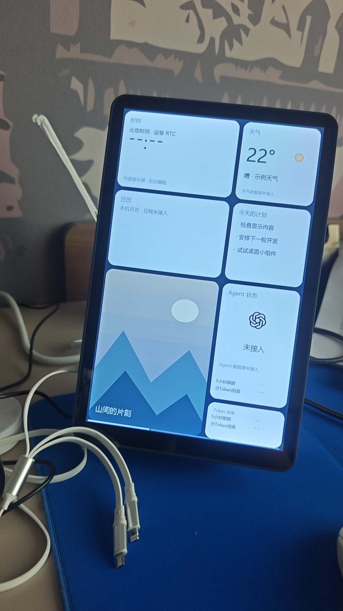

# 拉卡拉 CS80 客显屏 → Agent 状态副屏

一台 ¥30 的二手「拉卡拉客显屏 CS80」，**不改硬件**（原屏、原主板、原 Type-C/12V 供电，只刷固件），
改造成 800×1280 的副屏：多画布 + 组件拖拽编辑器 + 自定义页面 + 视频屏保，全部本地、无云依赖。



```
┌──── 主机（macOS / Windows）────────────┐   USB (Type-C, QDC1)   ┌── CS80 (EC600U) ──┐
│ 桌面壳（Tauri）→ 浏览器画布 800×1280    │ ───────────────────►  │ 解 LZ4 → framebuffer│
│  host.py：独占 USB + 本地 HTTP + 数据源 │   整帧 / 局部 tile     │ cache-clean → DSI   │
│  qdc1（C sidecar）：IOKit / COM        │   BGR565, patch 64 B   │ → SC7705 面板       │
└────────────────────────────────────────┘                        └─────────────────────┘
```

## 能做什么

| 能力 | 说明 |
|---|---|
| 画布 | 5×8 网格（每格 160 px），组件拖拽/缩放/复制，多画布 tab 切换 |
| 组件 | 时钟、时钟（表盘/LCD 数码管）、股票（A 股/美股/期货按时段自动切）、K 线、加密、GitHub、天气、电脑指标、Agent、RunCat、RunCat 条、音乐、倒计时、便签、资讯、假期倒计时 |
| 自定义页面 | 写一个 ES 模块直接画整屏（示例：自选股 + 分时图，见 `panel/web/pages/stock.js`） |
| Agent 状态 | 自动扫描本机 Pi / Claude Code / Codex / DeepSeek Harness 的会话，列表按「运行中 → 等待 → 结束」排序，可逐条隐藏 |
| 屏保 | 选视频（内置 `wallpaper.mp4`，也可用 `panel/add-screensaver.sh` 转自己的），手动播或锁屏自动播 |
| 控屏 | 亮度（5–100）、待机/唤醒、设备状态回读 |
| 喇叭 | 上传 MP3（≤4 MiB）并播放、音量、停止；固件自带音频通路，PA 自动开关 |
| 自检 | 每帧用 `VERIFY` 回读设备 framebuffer 哈希，patch 链哈希必须对上才算成功 |

## 买第二台设备怎么接（10 步）

> 全流程只在 **Windows + macOS** 走通过；刷机只有 Windows 能做（macOS 上 BootROM 口被拒）。

1. **确认是同款**：主板丝印 `CS80 MB V10`，屏 FPC `H.101.001B02`，模组 `EC600UCNLBR03A04M08`。
   细节见 [`docs/hardware.md`](docs/hardware.md)。
2. **Windows 上刷 QDisplay 固件**（只写 APP 分区，不动 NV）：
   `cd win-flash/flash && py\python.exe qdisplay_app.py ..\..\win-display\qdisplay\qdisplay_native.bin --auto`
   完整前置/流程/坑：[`docs/firmware.md`](docs/firmware.md)。
3. **验证固件**：屏上应该显示内置的「等待连接」页；客户端连上后会报 `block=520192`、特性位 `0x23f`。
4. **拷贝 `panel/` 到目标机器**，编译 sidecar：
   - macOS：`clang -O2 -o panel/qdc1 panel/qdc1.c panel/lz4.c -framework IOKit -framework CoreFoundation`
   - Windows：`cl qdc1.c lz4.c /Fe:qdc1.exe`（详见 [`docs/windows.md`](docs/windows.md)）
5. **确认数据通道**：
   - macOS：固定走 **USB 接口 32**（IOKit，免 root），不用做任何事
   - Windows：`qdc1.exe --probe` 找哪个 COM 口回 QDC1 HELLO，然后 `set CS80_COM=COMxx`
6. **起 host**：`python3 panel/host.py`（或直接跑打包好的桌面壳，它会自己拉起 host）。
7. **确认在线**：`curl 127.0.0.1:8787/api/status` → `device=up`、`ready.block=520192`。
8. **打包桌面壳**（可选）：`cd panel/shell && npm i && npx tauri build` → `.app` / `.msi`。
   新增 `panel/web/**` 文件时记得同步 `src-tauri/tauri.conf.json` 的 `bundle.resources`。
9. **校屏**：亮度想完全不闪就设 100（`<100` 时固件用 1 kHz 软件 PWM 调光，中间灰会轻微抖）；
   host 会**记住你设的亮度**（`~/.cs80_panel/config.json`，断电重连后自动恢复），不再自己刷成 100。
   要强制锁死某个值就 `set CS80_BRIGHTNESS=100`。再检查 `VERIFY` 是否一致（不一致说明像素格式或字节序错）。
   屏自身在闪：按 [`docs/troubleshooting.md`](docs/troubleshooting.md#屏闪) 的四步定位；
   如果是 0.3.1 固件等待页每秒一下，用 `win-flash/flash/patch_waiting_page.py` 打补丁。
10. **长期运行**：桌面壳带托盘 + 关窗不退出 + host 监督线程（host 死了自动重启）；
    开机自启用系统登录项。

## Linux（无桌面 / usbfs）

Linux 上没有 IOKit，`libusb` 又因为内部 32 位接口位图**打不开接口 32**（`LIBUSB_ERROR_INVALID_PARAM`），
所以 sidecar 直接用 usbfs ioctl。`qdc1.c` 已带 `__linux__` 分支：自动按 VID:PID 找 `/dev/bus/usb/BBB/DDD`，
用 `USBDEVFS_DISCONNECT_CLAIM` 踢掉 `option` 驱动并 claim 接口 32，再走 `USBDEVFS_BULK`。

```bash
cd panel
gcc -O2 -o qdc1 qdc1.c lz4.c
./qdc1 --hello                     # {"qdc1":true,"block":520192}
python3 host.py --port 8787        # 浏览器/SSH 隧道访问 http://127.0.0.1:8787
```

- 需要 root，或给 `2c7c:0901` 加 udev 规则（`MODE="0660" GROUP="plugdev"`）。
- 首次 claim 会把接口 32 从 `option` 驱动上摘下来（`ttyUSB6` 消失），这是正常的。
- `host.py` 默认只绑 `127.0.0.1`；局域网访问用 `--host 0.0.0.0`（界面无鉴权，仅限可信内网），或 `ssh -L 8787:127.0.0.1:8787`。
- Linux 下锁屏/显示器休眠联动不可用，其余功能（帧、patch、屏保、音频）一致。

## 已验证的现状

| 项 | 值 |
|---|---|
| 设备 | CS80 + EC600U-CN（UIS8910），QDisplay native 固件写在 `0x60260000` |
| 主机 | macOS（arm64，本仓主力）、Windows（见 `docs/windows.md`，需你实机确认 COM 映射） |
| 传输 | macOS IOKit 接口 32 / Windows 厂商虚拟串口，QDC1 协议 |
| 带宽 | 实测 **10.5 MB/s**（整帧裸 2 MB → 195 ms；LZ4 后 ~50 KB → 20 ms） |
| 常态刷新 | 局部 patch **64 B / 1–2 ms**；屏保视频 12 fps（250 KB/帧、59 ms/帧） |
| 恢复 | `win-flash/flash/fw.pac` 可整包刷回 QuecPython |

## 目录

```
docs/                文档（硬件 / 固件 / 协议 / 排障 / 走过的死路 / Windows）
panel/               客户端：host.py（常驻）+ web/（画布编辑器）+ qdc1.c（USB sidecar）+ shell/（Tauri 壳）
  run.sh             macOS 启动脚本（host + Chrome 应用窗口）
  run-windows.cmd    Windows 启动脚本（host + Edge/Chrome 应用窗口，无需 Rust）
  qdc1_ping.py       QDC1 探活/状态查询（刷机后验证固件跑起来没有）
  flicker_probe.py   屏闪探针：整屏纯色 + 可调重复提交频率
win-flash/           刷机与恢复工具 + 官方 QuecPython 固件包（新设备必需）
  flash/appimg.py            APP2 容器 CRC32（手改固件字节后必须重算）
  flash/make_waiting_page.py 生成等待页（纯黑白，不闪）
  flash/patch_waiting_page_image.py  把生成的页面换进固件 BIN
  flash/patch_waiting_page.py        0.3.1 等待页倒计时重绘补丁
  flash/reset_download.py    卡在下载模式时用 BSL 复位（不用拔插）
win-display/         官方 Windows 上位机安装包 + 固件 bin（0.3.0 / 0.3.1）+ 摄像头验证脚本
archive/quecpython/  QuecPython 时代的工具（历史留档，见 docs/dead-ends.md）
```

## 文档索引

| 文档 | 什么时候看 |
|---|---|
| [`docs/hardware.md`](docs/hardware.md) | 换设备/查引脚/要写自己的固件时 |
| [`docs/firmware.md`](docs/firmware.md) | 刷固件、恢复 QuecPython |
| [`docs/protocol.md`](docs/protocol.md) | 要写别的客户端（Linux/手机/单片机） |
| [`docs/troubleshooting.md`](docs/troubleshooting.md) | 屏不亮/掉线/画面不更新 |
| [`docs/windows.md`](docs/windows.md) | Windows 上编译 sidecar、找 COM 口、验收清单 |
| [`docs/dead-ends.md`](docs/dead-ends.md) | 别重复踩的坑（含为什么放弃 QuecPython） |
| [`panel/README.md`](panel/README.md) | 客户端架构、组件、页面、配置项 |

## 素材与许可

- 猫素材：[runcat-dev/RunCat365](https://github.com/runcat-dev/RunCat365) 的 `cat_running_*.png`（Apache-2.0）
- Agent logo：Pi / Claude / OpenAI 取自 [warp](https://github.com/warpdotdev/warp)（其仓库内资源），DeepSeek 取自 [simple-icons](https://github.com/simple-icons/simple-icons)
- 农历表：[solarlunar](https://www.npmjs.com/package/solarlunar)（ISC）
- 网格交互：[gridstack.js](https://github.com/gridstack/gridstack.js)（MIT）
- 设计语言参考：[glanceapp/glance](https://github.com/glanceapp/glance)
- 固件与协议逆向：[StevenLang233/lakala-display-re](https://github.com/StevenLang233/lakala-display-re)

屏保视频 `panel/web/media/wallpaper.mp4` 为用户自带素材，未包含在上述开源许可内。
